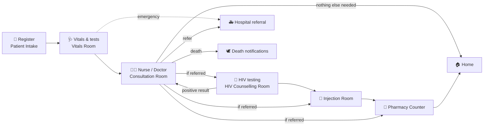
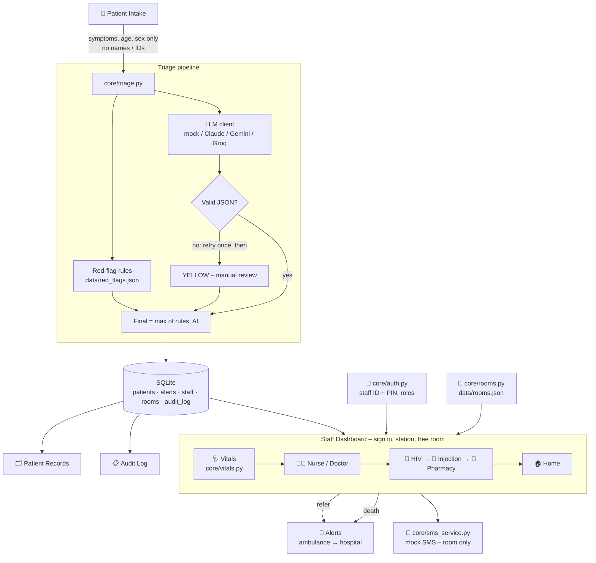

# 🏥 ClinicQ — AI Patient Intake, Triage & Clinic Flow for Public Clinics

> ⚠️ **ClinicQ supports clinic staff and does not diagnose. In an emergency, go straight to the nurse or call 10177.**

ClinicQ is a working prototype built for an AI bootcamp final project. It follows a patient through a whole
South African public clinic visit: **registration → vitals → nurse/doctor → HIV testing → injection room →
pharmacy → home**, with hospital referral and emergency alerts along the way.

It is a **decision-support** tool. AI helps capture and structure the patient's story and flag urgent patients
early, but **staff make every clinical decision**.

---

## 1. Problem statement

South African public clinics have long queues, and patients are often not assessed by urgency until late in the
day. A person with chest pain can sit behind ten people waiting for repeat medication. Intake notes are written by
hand, patients describe their symptoms in **isiZulu, Sesotho, Sepedi, Afrikaans or English**, and staff in
different rooms (vitals, consultation, pharmacy…) have no shared view of who is where.

## 2. What ClinicQ does

| | |
|---|---|
| 📝 **Registers patients** | Personal details, ID document, next of kin, POPIA consent, and symptoms in the patient's own words in 5 languages. |
| 🚩 **Flags danger early** | Red-flag rules (no AI) catch danger signs such as chest pain, pregnancy bleeding or a child who isn't drinking, and force the patient to the top of the queue. |
| 🤖 **Structures with AI** | An LLM translates and summarises the symptoms and suggests a triage colour. It never receives names, ID numbers or addresses. |
| 🩺 **Guides the clinic flow** | Each station has its own queue: Vitals → Nurse/Doctor → HIV testing → Injection → Pharmacy. Patients are ordered by urgency and fair waiting time. |
| 🚪 **Manages rooms** | 14 named rooms. Staff select a free room; one patient per room at a time, for privacy. |
| 🔐 **Secures access** | Personal staff ID + PIN, roles, account lockout and automatic sign-out. |
| 🚑 **Coordinates emergencies** | Hospital referral alerts the ambulance coordinator, then the receiving hospital. A death alerts the facility manager. |
| 🗂️ **Keeps records** | A searchable patient database and a full audit log of who did what, and when. |

## 3. The patient journey



| Step | Who | What happens |
|---|---|---|
| **1. Registration** | Patient or clerk – *Patient Intake* | First name, surname, ID document (SA ID, passport, asylum/refugee permit, or none), age, sex, address, contact number, **next of kin**, pregnancy, chronic conditions, **POPIA consent**, and *"Describe how you are feeling"* in any of the 5 languages. SA ID numbers are checked (checksum and date of birth must match the age). The patient gets a **queue number ticket**. |
| **2. Triage** | Automatic | **Red-flag rules run first** and can only raise urgency. The **AI** suggests a colour; if its answer is invalid it is retried once, then falls back to **YELLOW – manual review**. Final colour = the higher of rules and AI. |
| **3. Vitals & tests** | Nurse – *Vitals Room* | BP, temperature, pulse, urine **infection** and **pregnancy** tests. Dangerous readings raise the colour. A **positive pregnancy test re-checks the pregnancy danger signs**. The nurse **confirms the colour** (choosing a lower colour needs a reason) and can write a **note for the Nurse/Doctor**. |
| **4. Nurse / Doctor** | Nurse or doctor – *Consultation or Emergency Room* | Sees the complaint, the patient's own words and translation, vitals, **the vitals nurse's note**, AI-suggested questions and, later, the HIV result. Writes the **assessment & prescription** and ticks the rooms the patient needs. They always go in the order **🧪 HIV testing → 💉 Injection → 💊 Pharmacy**, or home if nothing is ticked. Can also **refer to hospital** or **record a death**. |
| **5. HIV testing** | HIV counsellor or nurse – *HIV Counselling Room* | Records **pre-test counselling & consent** and the **result** (Negative / Positive confirmed with a second test / Inconclusive / Declined). **A positive result must go back to the Nurse/Doctor** for ART initiation and linkage to care; the remaining rooms are kept. |
| **6. Injection room** | Nurse – *Injection Room* | Sees the prescription and the route, gives the injection, then sends the patient on. |
| **7. Pharmacy** | Pharmacist – *Pharmacy Counter* | Sees the prescription, hands over the medication, and the visit ends (**🏠 Home**). |

At every room the staff member **calls** the next patient (a simulated SMS tells the patient which room to go to),
does their work, and presses **Done** to send them to the next room. **Not here** puts a patient who didn't come
back in the queue without losing their place.

### What the triage colours mean

Every patient gets a colour that decides how soon they are seen. The Home page and the Staff Dashboard show this
key, so everyone reads the colours the same way.

| Colour | Meaning | How soon | Examples |
|---|---|---|---|
| 🔴 **RED** | Emergency – life may be in danger | **See immediately** | chest pain, difficulty breathing, unconscious, seizure, heavy bleeding, pregnancy danger signs, a child who is not drinking |
| 🟠 **ORANGE** | Very urgent – could become dangerous soon | **Within 10 min** | high fever, burns, severe pain, head injury, coughing blood, very high blood pressure |
| 🟡 **YELLOW** | Urgent – needs to be seen today | **Within 1 hour** | cough for many days, moderate pain, the AI could not read the entry (manual review) |
| 🟢 **GREEN** | Routine – not urgent | **Within 4 hours** | repeat medication, mild cold, check-up |

- **Where colours come from:** the red-flag rules and the AI. Dangerous vital signs can raise a colour, and the vitals nurse always confirms it.
- **Other markers:**
  - **⏰ OVERDUE** means the patient has waited longer than the target time for their colour.
  - **⬆️ Moved up** means a GREEN patient waiting over 4 h now queues with YELLOW patients.
- **Waiting bar** on each patient card:
  - teal = within target;
  - amber = over half the target;
  - red = overdue.

### Queues and fair waiting
- **Order:** every station orders its queue RED → ORANGE → YELLOW → GREEN, then arrival time.
- **Overdue patients:** South African Triage Scale (SATS) target times (RED immediately, ORANGE ≤ 10 min, YELLOW ≤ 1 h, GREEN ≤ 4 h) flag **⏰ OVERDUE** patients.
- **No one waits forever:** a GREEN patient waiting more than 4 h moves up to queue with YELLOW. RED and ORANGE are never jumped.

### Emergencies
- **🚑 Refer to hospital** (Vitals or Nurse/Doctor): the **ambulance coordinator** is alerted. When they record the ambulance reference and ETA, the **receiving hospital is alerted** with a handover summary.
- **🕊️ Record death:** the **facility manager** is alerted, and tasks are created to certify the death, **inform the next of kin in person or by phone** (never by SMS), and report to SAPS if the death is unnatural.

## 4. Pages and who uses them

| Page | Who | What it is for |
|---|---|---|
| 🏠 **Home** | Everyone | Live clinic overview: patients waiting per station and per colour, overdue, open alerts, rooms in use. Also the **colour key**, the patient journey, what ClinicQ does, *"Which page do I use?"* and the demo controls. |
| 📝 **Patient Intake** | Patients / clerk (no sign-in) | Registration form → queue number ticket. Staff can enter an earlier arrival time. |
| 🩺 **Staff Dashboard** | Nurses, doctors, pharmacists, HIV counsellors | **Sign in** → choose your **station** and a **free room** → your station's queue → **Call now** → the **"With you now"** card shows the form for your station → **Done** sends the patient on. A compact **colour key** sits above the queue, with a rooms overview and a live count per station. |
| 🚨 **Alerts** | Every signed-in role (mainly ambulance coordinator & facility manager) | Ambulance requests, hospital notifications, death follow-up tasks. A pulsing badge on every page shows open alerts. |
| 🗂️ **Patient Records** | Nurses, doctors, facility manager, admin | Search all visits, full patient details, earlier visits, CSV export. Every record opened is logged. |
| 📋 **Audit Log** | Facility manager, admin | Every triage decision, colour change, room, station move, alert, sign-in and record view, with time and staff name. CSV export. |
| 👥 **Staff** | Everyone: change own PIN. Admin: manage accounts | Add staff, reset PINs, unlock, deactivate, add demo accounts, free a stuck room. |

### What each role can do

| Role | Stations | Pages |
|---|---|---|
| Nurse | Vitals, Nurse/Doctor, Injection, HIV testing | Records, Alerts |
| Doctor | Nurse/Doctor, Vitals, Injection | Records, Alerts |
| Pharmacist | Pharmacy | Alerts |
| HIV counsellor | HIV testing | Alerts |
| Ambulance coordinator | — | Alerts |
| Facility manager | — | Records, Alerts, Audit Log |
| Admin | All | Everything, incl. Staff management and Reset |

- **The role belongs to the staff account; staff cannot choose it.** After sign-in, the station list only shows the stations that role allows. A nurse is never offered 💊 Pharmacy, and a pharmacist only sees 💊 Pharmacy.
- **Nurses may do HIV testing on purpose:** in South African clinics, professional nurses routinely do HIV testing and start ART. To limit HIV rooms to counsellors, change `ROLES` in `core/auth.py`.
- **Using someone else's ID and PIN** is the only way to act as another role. That is why PINs are personal, and every action is logged under the account that did it. (Fingerprint sign-in is a planned improvement.)

### Rooms (`data/rooms.json`)

| Rooms | Station |
|---|---|
| Vitals Room 1–2 | 🩺 Vitals & tests |
| Consultation Room 1–4 | 👩‍⚕️ Nurse / Doctor |
| Emergency Room 1 (Resus), Emergency Room 2 | 👩‍⚕️ Nurse / Doctor and 🩺 Vitals (emergencies) |
| HIV Counselling Room 1–3 | 🧪 HIV testing |
| Injection Room | 💉 Injection room |
| Pharmacy Counter 1–2 | 💊 Pharmacy |

- **Choosing a room:** staff choose from a dropdown (no typing) that only lists **free rooms for their station**.
- **Reserved while in use:** a room is reserved while someone works in it and freed when they sign out or change room. It also frees itself after 30 min without activity, unless a patient is still inside.
- **Stuck rooms:** an admin can free a stuck room on the Staff page.
- **Your clinic's layout:** edit `data/rooms.json` to match it.

## 5. Safety, privacy and security

| | |
|---|---|
| **Rules before AI** | Red-flag rules and vital-sign checks can only **raise** urgency; the AI can never lower them. |
| **Human in the loop** | The vitals nurse confirms every colour; lowering it needs a written reason. Staff make every prescription decision; the AI never suggests treatment. |
| **No personal data to the AI** | Only symptoms, age, sex, pregnancy and chronic conditions are sent. A test enforces this. |
| **Staff sign-in** | Personal staff ID + PIN. PINs are hashed (PBKDF2) and never stored as text. Weak PINs are refused. An account is **locked for 15 min after 5 wrong PINs**, and staff are **signed out after 30 min idle**. Roles limit stations and pages. |
| **Masked on screens** | Dashboards show `*********0087` and `082***4567`. Addresses and next of kin only appear in Patient Records. |
| **HIV results** | Need-to-know only: nurses, doctors and HIV counsellors. Never in the Audit Log, CSV exports or SMS. |
| **SMS** | Queue number and room only – never the station (e.g. "HIV testing") or any health information. Next of kin are never told about a death by SMS. |
| **One patient per room** | Enforced in the database, so two staff can never call the same patient or share a room. |
| **Accountability** | Every action is logged with the staff member's name and ID. |

See [RESPONSIBLE_AI.md](RESPONSIBLE_AI.md) for the risks (under-triage, mistranslation, bias, privacy) and how
each one is addressed.

## 6. Architecture



### Project structure

```
clinicq/
  app.py                         Streamlit entry point: the page list (names + icons)
  home.py                        Home: live clinic overview, how it works, demo controls
  .streamlit/config.toml         Colour theme
  views/1_Patient_Intake.py      Registration form and queue-number ticket
  views/2_Staff_Dashboard.py     Sign in → station + free room → queue → "With you now" forms
  views/3_Audit_Log.py           Audit table + CSV export (managers & admins)
  views/4_Alerts.py              Ambulance, hospital and death alerts / tasks
  views/5_Patient_Records.py     Patient database (role-protected, every view logged) + CSV export
  views/6_Staff.py               Change my PIN; admin: staff accounts, demo accounts, free rooms
  core/models.py                 Pydantic models (intake, vitals, LLM output) + urgency ordering
  core/rules_engine.py           Red-flag rules (raise-only)
  core/llm_client.py             AI providers: mock / anthropic / gemini / groq
  core/triage.py                 Rules → AI (retry, fallback) → final colour
  core/vitals.py                 Vital-sign danger thresholds (raise-only)
  core/stations.py               The stations and the fixed referral order
  core/workflow.py               Vitals, prescription, HIV test, room-to-room, referral, death + alerts
  core/queue_manager.py          Per-station queues, overdue rules, calling, SMS triggers
  core/rooms.py                  Named rooms, which are free, room reservations
  core/auth.py                   Staff accounts, PIN hashing, lockout, roles
  core/auth_ui.py                Sign-in screen, role check, inactivity sign-out
  core/database.py               SQLite: patients, alerts, audit log, records search
  core/privacy.py                SA ID checks, ID/phone masking, ID removal from free text
  core/sms_service.py            Mock SMS + interface for a real gateway (Clickatell stub)
  core/demo.py                   Loads the 10 demo patients
  core/ui.py                     Design system: colours, colour key, headers, tiles, badges, disclaimer
  data/red_flags.json            Danger-sign phrases (English, isiZulu, Sesotho, Sepedi, Afrikaans)
  data/rooms.json                The clinic's 14 rooms
  data/contacts.json             Ambulance coordinator, facility manager, hospitals (placeholders)
  data/demo_staff.json           Demo staff accounts (classroom only)
  data/sample_patients.json      10 fictional demo patients in mixed languages
  prompts/triage_system_prompt.txt
  tests/                         160 pytest tests
  .env.example  requirements.txt  pytest.ini  README.md  RESPONSIBLE_AI.md
```

## 7. Setup on Windows (VS Code terminal)

You need **Python 3.10 or newer** (`python --version`). Open the VS Code terminal (**Ctrl + `**). It is
PowerShell by default.

```powershell
# 1. Go to the project folder
cd clinicq

# 2. Create and activate a virtual environment
python -m venv .venv
.\.venv\Scripts\Activate.ps1
#    If PowerShell blocks the script, run this once, then activate again:
#    Set-ExecutionPolicy -Scope CurrentUser -ExecutionPolicy RemoteSigned

# 3. Install requirements
python -m pip install --upgrade pip
pip install -r requirements.txt

# 4. Create your .env file from the example
copy .env.example .env

# 5. Run the tests
pytest -v

# 6. Start the app (opens http://localhost:8501 in your browser)
streamlit run app.py
```

**First start:** open the **Staff Dashboard**. Because there are no staff accounts yet, it shows **First-time
setup**. Either create your own administrator, or (for a classroom demo) click **Load demo staff accounts**. Then
click **Load demo patients** on the Home page.

### Signing in – common messages

| Message | What it means | What to do |
|---|---|---|
| *Wrong staff ID or PIN. N attempt(s) left…* | The ID and PIN do not belong together. ClinicQ deliberately does not say which one is wrong, so nobody can guess which staff IDs exist. | Check you are using **your own** ID with **your own** PIN from the demo table, e.g. Pharmacist Molefe is `P3002` + `3816`, not `P3001`. |
| *Too many wrong PINs. This account is locked…* | 5 wrong PINs in a row. | Wait 15 minutes, or ask an Admin to **Unlock** it on the Staff page. |
| *Your role (…) does not have access to this page.* | The page is not part of that role's work (e.g. a pharmacist on Patient Records). | Use a page your role can open (see the table above). |
| *You were signed out: no activity for 30 minutes.* | Automatic sign-out on shared computers; your room is freed. | Sign in again and choose a room. |
| *No free room for this station* | All rooms for that station are in use. | Wait for a colleague to finish, or ask an Admin to free a stuck room. |

### Settings (`.env`)

| Setting | Default | Meaning |
|---|---|---|
| `LLM_PROVIDER` | `mock` | `mock` (offline), `anthropic`, `gemini` or `groq` |
| `ANTHROPIC_API_KEY` / `ANTHROPIC_MODEL` | – / `claude-opus-5-5` | Claude |
| `GEMINI_API_KEY` / `GEMINI_MODEL` | – / `gemini-2.5-flash` | Google Gemini (free tier) |
| `GROQ_API_KEY` / `GROQ_MODEL` | – / `llama-3.3-70b-versatile` | Groq (free tier) |
| `SMS_PROVIDER` | `mock` | `mock` writes to `data/sms_outbox.log`; `clickatell` is a stub |
| `CLINICQ_SESSION_MINUTES` | `30` | Minutes of inactivity before staff are signed out and rooms are freed |

Restart `streamlit run app.py` after changing `.env`.

### AI providers
- **Mock (default):** no API key and works offline. Simple keyword logic returns realistic JSON. It is deliberately **less confident in non-English text**, which shows why the rules engine is needed as a safety net.
- **Claude:** `LLM_PROVIDER=anthropic` + `ANTHROPIC_API_KEY`. ClinicQ uses structured outputs (a JSON schema), so the reply always has the right shape. It runs at low effort, and server-side refusal fallbacks are on.
- **Gemini / Groq (free tiers):** `pip install google-genai` or `pip install groq`, then set the provider and key.

If a key is missing or the API is down, ClinicQ **keeps working**: the rules still run and the AI part falls back
to YELLOW – manual review. The sidebar shows which provider is active.

## 8. Demo

### Demo staff accounts (classroom only – the PINs are public)

**18 accounts:** 5 nurses, 2 doctors, 4 pharmacists, 2 HIV counsellors, 3 ambulance coordinators, 1 facility manager
and 1 admin. Different people can work in different rooms at the same time. There are **2 pharmacy counters**, so
2 pharmacists can be signed in to the pharmacy at once; add counters in `data/rooms.json` for more.

| Staff ID | Name                | Role                  | PIN    |
|----------|---------------------|-----------------------|--------|
| `N1001`  | Sr Dlamini          | Nurse                 | `4826` |
| `N1002`  | Sr Mokoena          | Nurse                 | `5937` |
| `N1003`  | Sr Khumalo          | Nurse                 | `6148` |
| `N1004`  | Sr van Wyk          | Nurse                 | `7259` |
| `N1005`  | Sr Pillay           | Nurse                 | `8360` |
| `D2001`  | Dr Naidoo           | Doctor                | `7391` |
| `D2002`  | Dr Mthembu          | Doctor                | `2947` |
| `P3001`  | Pharmacist Botha    | Pharmacist            | `5173` |
| `P3002`  | Pharmacist Molefe   | Pharmacist            | `3816` |
| `P3003`  | Pharmacist Nkosi    | Pharmacist            | `4729` |
| `P3004`  | Pharmacist Govender | Pharmacist            | `6152` |
| `C4001`  | Counsellor Zulu     | HIV counsellor        | `6284` |
| `C4002`  | Counsellor Ndlovu   | HIV counsellor        | `9153` |
| `A5001`  | Coordinator Sibiya  | Ambulance coordinator | `3917` |
| `A5002`  | Coordinator Mabuza  | Ambulance coordinator | `2783` |
| `A5003`  | Coordinator Daniels | Ambulance coordinator | `8516` |
| `M6001`  | Manager Mahlaba     | Facility manager      | `8462` |
| `ADMIN`  | Clinic Admin        | Admin                 | `9045` |

Every person has their **own** staff ID and PIN – use the ID and PIN from the same row (e.g. Pharmacist Botha is
`P3001` + `5173`, Pharmacist Molefe is `P3002` + `3816`). This table matches `data/demo_staff.json`.

**Never load these on a real system.** If you loaded an older set of demo accounts, sign in as `ADMIN` and press
**Add any missing demo staff accounts** on the Staff page.

### Demo patients
**Load demo patients** (Home page or Staff Dashboard) registers 10 **fictional** patients. They all start in the
Vitals queue. Their document numbers are clearly fake (`DEMO…`) or "No document", so no real person's ID is used.

| Patient | Language | Case | Colour (mock AI) | Decided by |
|---|---|---|---|---|
| Thabo, 58 M | English | Crushing chest pain | 🔴 RED | rules + AI agree |
| Nomsa, 27 F | English | 7 months pregnant, bleeding, baby moving less | 🔴 RED | rules + AI agree |
| Zanele, 63 F | isiZulu | Chest pain + difficulty breathing | 🔴 RED | **rules** (mock AI said ORANGE) |
| Kgosi, 2 M | Sesotho | Child: high fever, not drinking, very sleepy | 🔴 RED | **rules** (mock AI said ORANGE) |
| Pieter, 34 M | Afrikaans | Boiling-water burn with blisters | 🟠 ORANGE | **rules** (mock AI said YELLOW) |
| Sipho, 45 M | isiZulu | Cough 10 days, night sweats, weight loss | 🟡 YELLOW | AI |
| Busi, 39 F | English | Repeat diabetes medication, waiting 4.5 h | 🟢 GREEN (⏰ overdue, moved up) | AI |
| Annatjie, 71 F | Afrikaans | Repeat blood-pressure script | 🟢 GREEN | AI |
| Jason, 22 M | English | Mild cold | 🟢 GREEN | AI |
| Palesa, 30 F | Sesotho | Headache and flu | 🟢 GREEN | AI |

### 5-minute demo script
Use a separate browser window (or a private window) for each staff member, so each has their own sign-in.

1. **Home** – explain the problem, then click **Load demo patients**. Point out the live tiles and the **colour key** (what RED, ORANGE, YELLOW and GREEN mean and how soon each must be seen), then the journey.
2. **Patient Intake** – register someone in isiZulu or Sepedi (e.g. *"Ke palelwa ke go hema gabotse"*). Show the ticket and the staff view: the **rules caught the danger sign**.
3. **Sr Dlamini (N1001)** – Staff Dashboard → Vitals → *Vitals Room 1*. Call the RED patient at the top, enter a temperature of **39.5 °C**, and add a note → the colour rises; send to the Nurse/Doctor.
4. **Dr Naidoo (D2001)** – Nurse/Doctor → *Consultation Room 1*. Show the **vitals note**, write a prescription, and tick **HIV testing, Injection and Pharmacy**.
5. **Counsellor Zulu (C4001)** – HIV testing → *HIV Counselling Room 1*. Record consent and a **positive** result. Show that "continue" is refused, and send the patient **back to the Nurse/Doctor**.
6. **Dr Mthembu (D2002)** – sees the HIV result, records ART initiation; the injection and pharmacy rooms are still ticked.
7. **Sr Khumalo (N1003)** → *Injection Room*, then **Pharmacist Botha (P3001)** → *Pharmacy Counter 1*. Show the route on each card, and that the **pharmacist cannot see the HIV result** → patient goes home.
8. **Emergency** – as Dr Naidoo, **Refer to hospital** another patient. Then as **Coordinator Sibiya (A5001)** on **Alerts**, enter an ambulance reference → the hospital is alerted.
9. **Manager Mahlaba (M6001)** – **Patient Records** (HIV result shows as 🔒 Restricted) and the **Audit Log** (every step with a name).

## 9. Tests

```powershell
pytest -v
```
The 160 tests check, among other things, that:
- **red-flag rules can never be downgraded by the AI** (every rules × AI combination), and invalid AI output falls back safely to YELLOW;
- danger signs are caught in all 5 languages, and pregnancy and child rules only apply when relevant;
- **names, ID numbers, addresses and phone numbers are never sent to the AI**;
- SA ID numbers are validated, and consent and next of kin are required;
- dangerous vitals raise the colour, lowering it needs a reason, and a positive pregnancy test re-checks pregnancy danger signs;
- referred rooms always follow **HIV testing → injection → pharmacy**; HIV testing needs consent; a positive result must return to the Nurse/Doctor; HIV results are hidden from non-clinical roles and never appear in the audit log or exports;
- PINs are hashed, weak PINs are refused, accounts lock after 5 wrong PINs, and roles limit stations and pages;
- only free rooms for the station are offered, two staff can never take the same room or call the same patient, and room names are kept exactly;
- hospital referral alerts the ambulance coordinator, then the hospital; a death alerts the facility manager; **next of kin never get an SMS**;
- SMS texts never name the station; queue order, overdue rules and the audit log all work.

## 10. Screenshots

> Replace these placeholders with your own screenshots (put them in a `docs/` folder).

| Page | Screenshot |
|---|---|
| Home | `` |
| Patient Intake | `` |
| Staff Dashboard – sign in | `` |
| Staff Dashboard – vitals | `` |
| Staff Dashboard – HIV testing | `` |
| Alerts | `` |
| Patient Records | `` |
| Audit Log | `` |

## 11. Future improvements

- **Fingerprint sign-in** with WebAuthn / passkeys (Windows Hello or a phone's fingerprint sensor). The fingerprint is checked on the device and never stored by ClinicQ, which is the POPIA-safe way to use biometrics.
- **Before real use:**
  - connect sign-in to the department's staff directory;
  - **encrypt the database**;
  - use a secure channel for hospital handovers;
  - apply POPIA data-retention rules;
  - have the clinical team approve the vital-sign thresholds and the non-English phrase lists.
- **Real SMS gateway:** finish `ClickatellSMSService.send()` and set `SMS_PROVIDER=clickatell`.
- **WhatsApp intake**, so patients can describe their symptoms before they arrive.
- **Voice input** in all five languages, for patients who cannot read or write.
- **More languages:** isiXhosa, Setswana, Xitsonga, Tshivenda…
- **SpO₂ and respiratory rate** at vitals, and the full SATS TEWS score.
- **ML urgency model** trained on nurse-confirmed triage outcomes (the audit log already collects them), checked for bias across languages, ages and sexes.
- **Integration** with the national patient registration system and electronic referral letters.

## 12. Responsible AI

See [RESPONSIBLE_AI.md](RESPONSIBLE_AI.md).
